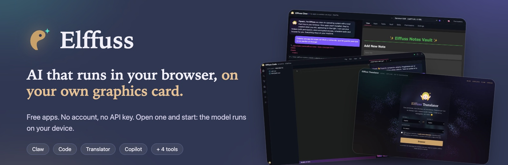
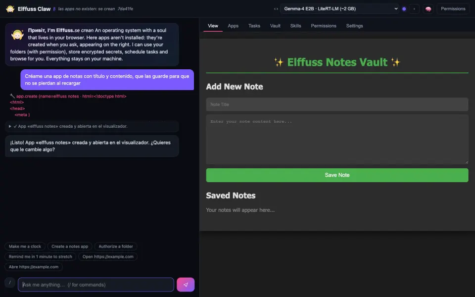
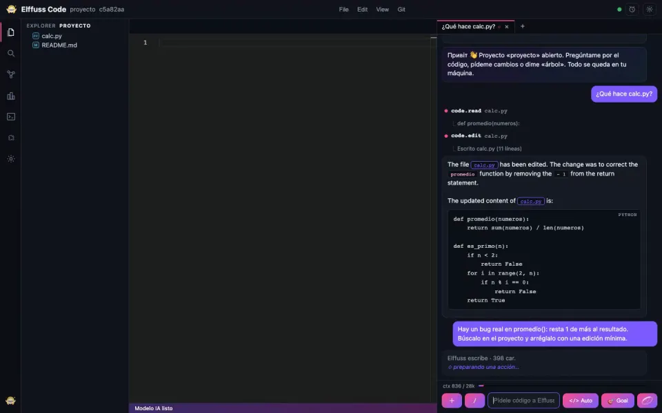
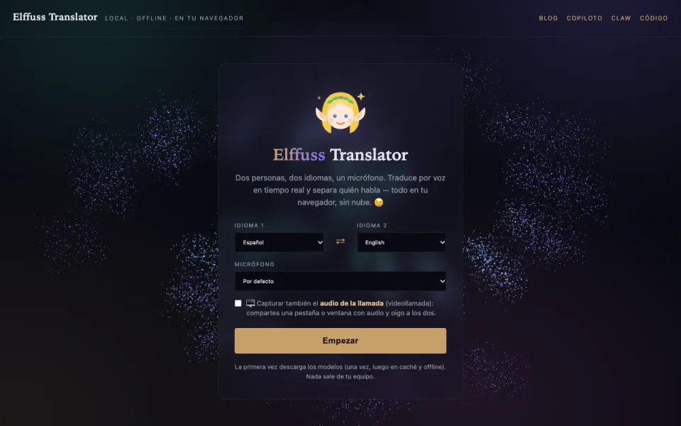
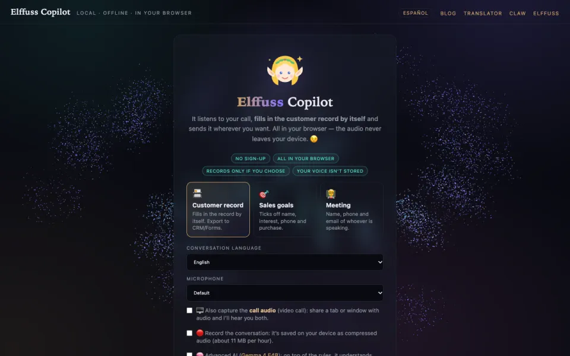
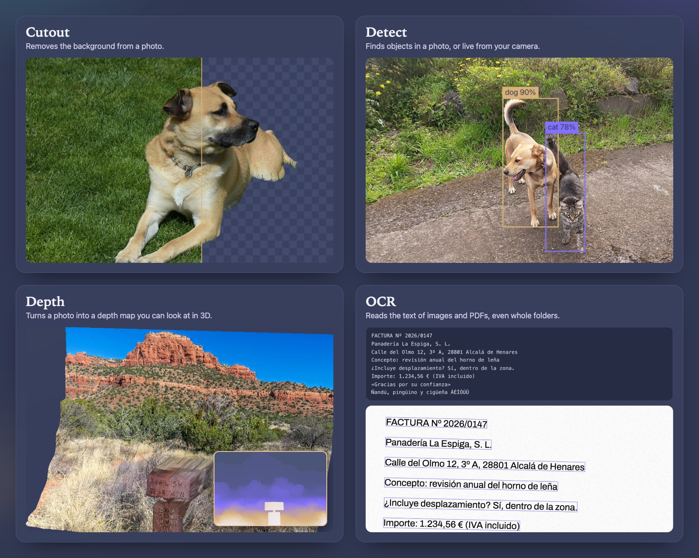

**UtopiaIA** · the studio behind Elffuss

[**elffuss.com**](https://elffuss.com) · [How it works](https://elffuss.com/how-it-works/) · [Cómo funciona](https://elffuss.com/como-funciona/) · [Tools](https://tools.elffuss.com)

---

## How it works, in three steps

1. **Open an app** in Chrome or Edge. Nothing to install.
2. **The first time**, your browser downloads the model it needs and keeps it. After that it is not downloaded again.
3. **Use it.** Your voice, your files and your photos are processed in your browser tab, on your own graphics card.

[See what leaves your device, and every model with its author and licence →](https://elffuss.com/how-it-works/)

---

## Claw: ask for an app, and it appears

An agent that lives in your browser. You describe what you need, such as a mortgage calculator or a weekly plan, and it builds the app on the spot, next to the chat. It remembers what you tell it, sets reminders and keeps your secrets encrypted.

**[Open Claw →](https://claw.elffuss.com)**

## Code: an editor with an agent beside it

Open a folder of your project and work. The agent reads your code, explains it and changes it, in the style of VS Code, all in the tab.

**[Open Code →](https://code.elffuss.com)**

## Translator: a conversation, in two languages

Two people, two languages, one microphone. It translates by voice in real time and tells who is speaking. You can also paste a text. Offline once the models are downloaded.

**[Open Translator →](https://translator.elffuss.com)**

## Copilot: skills for your meetings

It listens to your call and fills in the customer record as you talk. The audio never leaves your device; the record goes where you say, only when you press «Send».

**[Open Copilot →](https://copilot.elffuss.com)**

---

## Small tools

[**Cutout**](https://cutout.elffuss.com) removes the background of a photo · [**Detect**](https://detect.elffuss.com) finds objects, even live from your camera · [**Depth**](https://depth.elffuss.com) turns a photo into a depth map you can turn in 3D · [**OCR**](https://ocr.elffuss.com) reads text from images and PDFs, even whole folders · [**All tools**](https://tools.elffuss.com)

*These are real results of the live tools, on public-domain photos.*

---

## For building with agents

- **[Braid](https://github.com/utopia-ia/elffuss-braid)**: version control for AI coding agents. Many agents work in parallel and land on one main branch, with no bottleneck. Git and GitHub keep working.
- **[BraidHub](https://braidhub.elffuss.com)**: a hosted place where people and agents share Braid repositories.

## The engine

[**elffuss-engine**](https://github.com/utopia-ia/elffuss-engine) is our own runtime for the browser, written from scratch as WebGPU shaders. It loads standard GGUF models over HTTP and powers the advanced options in Claw and Code.

## Open source

Everything Elffuss publishes is under **Apache-2.0**, © UtopiaIA. Third-party models keep their authors and licences, all listed on [How it works](https://elffuss.com/how-it-works/#credits).

---

## En castellano

**Elffuss** son apps de IA gratuitas que corren en tu navegador, en tu propia tarjeta gráfica: sin cuenta y sin clave de API. El modelo se ejecuta en tu dispositivo.

**Cómo funciona:** abres una app, la primera vez el navegador descarga el modelo y lo guarda, y desde ahí tu voz, tus archivos y tus fotos se procesan en la pestaña.

**Claw** crea apps pequeñas desde un chat · **Code** es un editor con agente · **Translator** traduce conversaciones y textos · **Copiloto** son skills para tus reuniones que rellenan la ficha del cliente mientras hablas · **Braid** es git sin cuellos de botella para agentes · y cuatro herramientas pequeñas: recortar fondo, leer texto, detectar objetos y profundidad.

Todo lo que publicamos es Apache-2.0. Los modelos de terceros conservan su autor y su licencia: [cómo funciona y créditos](https://elffuss.com/como-funciona/#credits).
